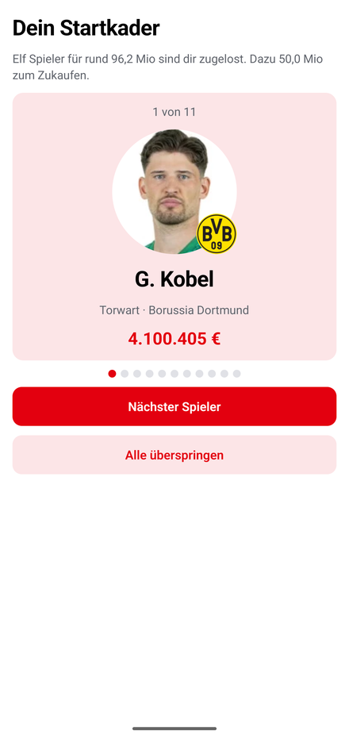

# Rivalleague

Ein Fantasy-Manager für die Bundesliga, gebaut für Freundesrunden: Jeder Mitspieler
führt in seiner Liga einen eigenen Kader aus echten Bundesligaspielern, stellt
wöchentlich auf und handelt mit den anderen auf einem Transfermarkt. Punkte kommen
aus den echten Spielen des Wochenendes.

<p align="center">
  
  
  
  
  
</p>

## Was die App kann

Der Reihe nach, so wie man es spielt:

- **Mehrere Ligen pro Konto.** Jede Liga hat einen eigenen Kader, ein eigenes Budget
  und eine eigene Tabelle. Gewechselt wird über das Dropdown in der Kopfzeile,
  beigetreten ausschließlich über einen Einladungslink.
- **Startkader per Losung.** Wer eine Liga anlegt oder ihr beitritt, bekommt elf
  Spieler für zusammen rund 100 Mio zugelost — keiner teurer als 20 Mio — und dazu
  50 Mio zum Zukaufen. Die elf werden einzeln aufgedeckt; danach steht man mit einer
  spielbaren Elf in der Tabelle statt vor einem leeren Kader.
- **Aufstellung auf dem Platz.** Die Startelf steht als Formation auf einem Rasen,
  eigenes Tor unten, Angriff oben — wie die Aufstellungsgrafik einer Übertragung.
  Sieben Formationen; jeder Platz öffnet dieselbe Auswahl, die nur Spieler der
  passenden Position zeigt, und bei einem besetzten Platz steht darunter der Knopf
  zum Rausnehmen. Jede Änderung geht sofort zum Server, auch die halb fertige Elf —
  es gibt keinen Speichern-Knopf, den man vergessen kann. Mit dem ersten Anpfiff des
  Spieltags friert die Aufstellung ein.
- **Punkte aus den echten Spielen.** Tore, Vorlagen, Karten, zu Null und eine
  Leistungsnote ergeben die Spieltagspunkte; dazu gibt es 20.000 € Prämie je Punkt.
  Die Spielerseite listet jede Partie einzeln auf — Gegner, Ergebnis, Minuten und die
  Punkte daraus — dazu Summe und Schnitt, der auch auf dem Feld und in der Kaderliste
  an jedem Spieler steht.
- **Transfermarkt mit verdeckten Geboten.** Jeder sieht nur sein eigenes Gebot. Über
  den Tag kommen laufend neue Spieler dazu, jedes Angebot hat seine eigene Laufzeit.
  Eigene Spieler bleiben auf dem Markt, bis jemand mindestens ihren Marktwert bietet.
- **Suche und Scouting.** Über dem Markt liegt eine Suche über alle Spieler, die schon
  beim Tippen antwortet. Bei jedem Treffer steht, ob er zu haben ist: frei, auf dem
  Markt, im eigenen Kader oder — mit Namen — im Kader eines Mitspielers. Wer
  interessant aussieht, bekommt einen Stern und steht beim nächsten Öffnen oben.
- **Marktwerte, die sich bewegen.** Jeden Abend um 22 Uhr wird jeder Spielerwert an
  seine Form der letzten drei Spieltage angepasst. Der Kursverlauf steht als Linie auf
  der Spielerseite, das eigene Gesamtvermögen im Ranking.
- **Aktivitätenfeed.** Alle Käufe und Verkäufe der Mitspieler und alles, was neu auf
  dem Markt liegt, in einem Zeitstrahl.
- **Der Kader der Mitspieler.** Ein Tipp auf eine Zeile der Tabelle zeigt, womit
  jemand vorne steht: Teamwert, Budget, Punkte und jeder einzelne Spieler.
- **Die App in den Farben des eigenen Vereins.** Beim ersten Start wählt man seinen
  Lieblingsverein; von da an trägt die Kopfzeile sein Wappen und seine Farbe, und
  Knöpfe, aktiver Reiter, Formationschips und alles, was einem selbst gehört, sind
  darauf abgestimmt. Die Farbe ist in hell und dunkel dieselbe — Schalkes Blau ist
  Schalkes Blau. Der Verein hängt am Konto, nicht an der Liga, und lässt sich im
  Profil wechseln, zusammen mit der Anzeige (System, Hell, Dunkel).
- **Vereinswappen an jedem Spieler**, in Kader, Markt, Suche und Feed — von welchem
  Verein einer kommt, sieht man, bevor man den Namen liest.

## Technisch interessant

Ein paar Entscheidungen, die das Projekt prägen:

**Kein Cron, nirgends.** Alles Zeitgesteuerte hängt am API-Aufruf: Wer den Markt
öffnet, rechnet nebenbei fällige Angebote ab und füllt nach; wer die Liga öffnet,
hält Spielplan, Statistiken und Marktwerte frisch. Der Zeitstempel hängt dabei am
Job und nicht am Nutzer — zehn Leute, die gleichzeitig die App öffnen, lösen einen
Lauf aus, nicht zehn. Das spart eine ganze Betriebsschicht, hat aber einen Preis:
öffnet tagelang niemand die App, passiert auch nichts.

**Das API-Kontingent ist die knappste Ressource.** Die Statistikquelle hat ein
Tageslimit. Deshalb liegt die Vorsaison-Statistik, aus der die Startmarktwerte
berechnet werden, als JSON am Spieler — eine Neukalibrierung der Formel kostet so
keinen einzigen API-Aufruf.

**Die Losung rechnet sich an das Ziel heran.** Elf Spieler für 100 Mio zu ziehen ist
ein Rucksackproblem, und das braucht hier niemand: Der Reihe nach wird für jeden
Formationsplatz das übrige Geld durch die noch offenen Plätze geteilt, und aus den
fünf Spielern, die diesem Zielwert am nächsten kommen, entscheidet der Zufall. Ein
teurer Griff macht die späteren Plätze automatisch billiger, die Summe landet in
Versuchen zuverlässig innerhalb weniger Prozent am Ziel — und zwei Manager bekommen
trotzdem nicht denselben Kader. Gelost wird eine 4-4-2, damit die erste Aufstellung
sicher aufgeht.

**Vereinsfarben stehen im Code.** Weder API-Football noch OpenLigaDB liefern sie, und
eine Farbe ändert sich seltener als ein Kader — also eine Tabelle in
`app/src/constants/vereinsfarben.ts`, je Verein ein Farbwert und die Schrift, die
darauf lesbar ist (bei Dortmunds Gelb muss sie dunkel sein). Fließtext bleibt immer
die normale Textfarbe; wo die Vereinsfarbe doch einmal Schrift ist — auf den ruhigen
Knöpfen —, wird sie vorher gegen den Hintergrund abgedunkelt oder aufgehellt, sonst
läse niemand Gelb auf Weiß.

**Zwei Datenquellen, bewusst.** Spieler und Statistiken kommen von API-Football, der
Spielplan von OpenLigaDB. Grund: Im kostenlosen Tarif von API-Football ist nur ein
Fenster von heute ± 1 Tag sichtbar — damit gäbe es keine Aufstellungs-Deadline im
Voraus. `Team.openligaId` verbindet beide Welten.

**Geld ist überall `Int` in ganzen Euro**, kein Float. Die Marktabrechnung läuft
vollständig in einer Transaktion: ein halb aufgelöster Markt, bei dem Geld
abgebucht, aber kein Spieler übertragen wurde, ist der eine Fehler, der eine
Freundesliga wirklich zerlegt.

**Zeitzonen ohne Bibliothek.** Marktschluss ist eine deutsche Ortszeit, gespeichert
wird UTC. `Intl` kennt die Regeln bereits, inklusive der beiden Umstellungstage —
getestet quer durch ein ganzes Jahr.

**Getestet wird das Reine.** Marktauflösung, Punktevergabe, Formationsprüfung,
Startkader-Losung, Marktwertkurve und Zeitrechnung liegen als Funktionen ohne
Datenbankzugriff in `server/lib/` und haben Tests (`node:test`, keine Frameworks).
Die Routen darüber sind dünn und machen nur die Datenbankarbeit.

## Stack

| Bereich  | Technik |
|----------|---------|
| App      | React Native, Expo SDK 57, Expo Router, TypeScript |
| Backend  | Next.js 16 (App Router, Route Handlers), TypeScript |
| Daten    | PostgreSQL 17, Prisma 7 |
| Auth     | JWT (jose), Bearer-Token |
| Quellen  | API-Football (Spieler, Statistiken), OpenLigaDB (Spielplan) |

## Aufbau

    app/                 Expo-App
      src/app/(tabs)/    Ranking, Kader, Markt, Aktivität
      src/app/           Spieler, Mitspieler, Suche, Losung, Verein, Profil, Login
      src/components/    Kopfzeile mit Liga-Dropdown, Spielfeld, UI-Bausteine
      src/constants/     Farben, Vereinsfarben
      src/lib/           API-Zugriff, Session, Thema, Speicher
    server/
      app/api/           Route Handlers, dünn gehalten
      lib/               Fachlogik, rein und getestet (*.test.ts daneben)
      prisma/            Schema und Migrationen
    docs/screenshots/    Bilder für diese Datei

## Lokal starten

Vorausgesetzt sind Node 22, Docker und ein API-Football-Schlüssel (kostenloser Tarif
genügt).

```bash
docker compose up -d                       # PostgreSQL auf :5434
cp server/.env.example server/.env         # JWT_SECRET, ADMIN_TOKEN, API_FOOTBALL_KEY eintragen
cd server && npm install && npm run migrate && npm run dev
cd app && npm install && npx expo start    # --android oder --ios
```

Welche Saison gespielt wird, steht in `server/.env`: `SEASON` ist die laufende
Spielzeit, `STATS_SEASON` die Vorsaison, aus der die Startmarktwerte kommen. Beide
sind getrennt, weil der kostenlose Tarif die aktuelle Statistik nicht herausgibt —
freigeschaltet ist nur bis 2024. Zum Saisonwechsel reichen die zwei Zeilen.

Die App findet das Backend von selbst: Sie nimmt die IP, über die Expo gerade den
Bundler ausliefert, und hängt Port 3000 an. Nur wenn das Backend woanders läuft,
braucht es `EXPO_PUBLIC_API_BASE` (siehe `app/.env.example`).

Erstbefüllung der Datenbank mit Spielern und Spielplan über die Admin-Endpunkte:

```bash
curl -X POST localhost:3000/api/admin/sync -H "x-admin-token: $ADMIN_TOKEN"
```

Tests:

```bash
cd server && npm test
```

## Stand

Ein laufendes Hobbyprojekt, ehrlich gesagt:

- Die Anmeldung ist ein Entwicklungs-Login mit freiem Namen; er ist in Produktion
  gesperrt, echtes OAuth kommt, sobald der Server unter fester Adresse läuft.
- Punkte- und Marktwertformeln sind kalibrierte Schätzungen und gehören nach ein
  paar echten Spieltagen gegen die tatsächliche Verteilung nachgezogen. Die
  Stellschrauben liegen dafür gesammelt in `server/lib/scoring.ts` und
  `server/lib/marketvalue.ts`.
- Punkte gibt es erst ab dem ersten Spieltag, den die App miterlebt. Der kostenlose
  Tarif gibt nur ein Fenster von heute ± 1 Tag her — vergangene Spieltage lassen sich
  nicht nachholen, auch nicht einmalig.
- Es gibt noch kein Deployment; entwickelt wird gegen lokales Postgres.

## Lizenz

MIT, siehe [LICENSE](LICENSE).
