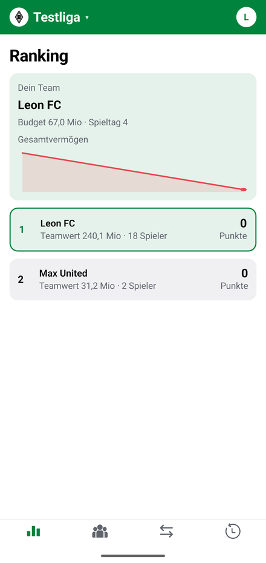
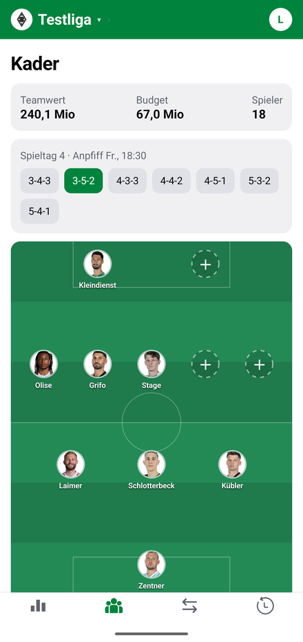
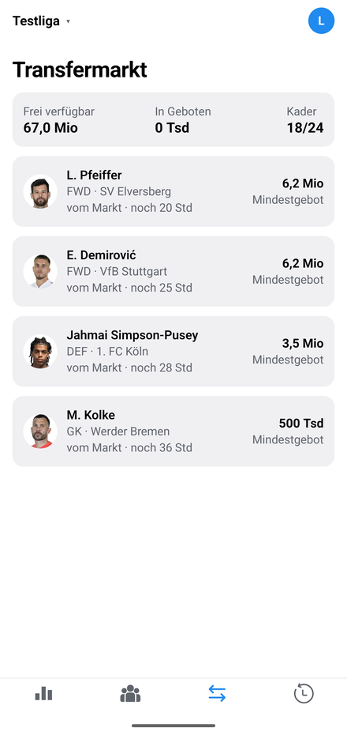
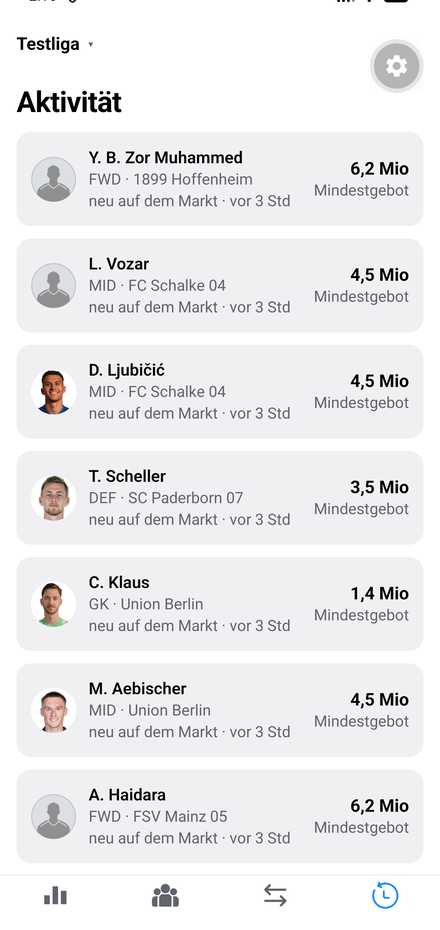

# Rivalleague

Ein Fantasy-Manager für die Bundesliga, gebaut für Freundesrunden: Jeder Mitspieler
führt in seiner Liga einen eigenen Kader aus echten Bundesligaspielern, stellt
wöchentlich auf und handelt mit den anderen auf einem Transfermarkt. Punkte kommen
aus den echten Spielen des Wochenendes.

<p align="center">
  
  
  
  
</p>

## Was die App kann

- **Mehrere Ligen pro Konto.** Jede Liga hat einen eigenen Kader, ein eigenes Budget
  und eine eigene Tabelle. Gewechselt wird über das Dropdown in der Kopfzeile,
  beigetreten ausschließlich über einen Einladungslink.
- **Aufstellung auf dem Platz.** Die Startelf steht als Formation auf einem Rasen,
  eigenes Tor unten, Angriff oben — wie die Aufstellungsgrafik einer Übertragung.
  Sieben Formationen, leere Plätze werden einzeln besetzt und die Auswahl zeigt nur
  Spieler der passenden Position; darunter liegt der komplette Kader nach Positionen
  sortiert. Mit Anpfiff des Spieltags friert die Aufstellung ein.
- **Transfermarkt mit verdeckten Geboten.** Jeder sieht nur sein eigenes Gebot.
  Über den Tag kommen laufend neue Spieler dazu, jedes Angebot hat seine eigene
  Laufzeit. Eigene Spieler bleiben auf dem Markt, bis jemand mindestens ihren
  Marktwert bietet.
- **Marktwerte, die sich bewegen.** Jeden Abend um 22 Uhr wird jeder Spielerwert an
  seine Form der letzten drei Spieltage angepasst.
- **Aktivitätenfeed.** Alle Käufe und Verkäufe der Mitspieler und alles, was neu auf
  dem Markt liegt, in einem Zeitstrahl.
- **Punkte nach echten Spielen**, inklusive Prämie: 20.000 € je Spieltagspunkt.
- **Punkte je Spiel pro Spieler.** Die Spielerseite listet jede Partie einzeln auf —
  Gegner, Ergebnis, Einsatzminuten und die Punkte daraus — dazu Summe und Schnitt.
  Der Schnitt steht auch an jedem Spieler auf dem Feld und in der Kaderliste.

## Technisch interessant

Ein paar Entscheidungen, die das Projekt prägen:

**Kein Cron, nirgends.** Alles Zeitgesteuerte hängt am API-Aufruf: Wer den Markt
öffnet, rechnet nebenbei fällige Angebote ab und füllt nach; wer die Liga öffnet,
hält Spielplan, Statistiken und Marktwerte frisch. Der Zeitstempel hängt dabei am
Job und nicht am Nutzer — zehn Leute, die gleichzeitig die App öffnen, lösen einen
Lauf aus, nicht zehn. Das spart eine ganze Betriebsschicht, hat aber einen Preis:
öffnet tagelang niemand die App, passiert auch nichts.

**Das API-Kontingent ist die knappste Ressource.** Die Statistikquelle hat ein
Tageslimit. Deshalb liegt die Vorsaison-Statistik, aus der die Startmarktwerte
berechnet werden, als JSON am Spieler — eine Neukalibrierung der Formel kostet so
keinen einzigen API-Aufruf.

**Zwei Datenquellen, bewusst.** Spieler und Statistiken kommen von API-Football, der
Spielplan von OpenLigaDB. Grund: Im kostenlosen Tarif von API-Football ist nur ein
Fenster von heute ± 1 Tag sichtbar — damit gäbe es keine Aufstellungs-Deadline im
Voraus. `Team.openligaId` verbindet beide Welten.

**Geld ist überall `Int` in ganzen Euro**, kein Float. Die Marktabrechnung läuft
vollständig in einer Transaktion: ein halb aufgelöster Markt, bei dem Geld
abgebucht, aber kein Spieler übertragen wurde, ist der eine Fehler, der eine
Freundesliga wirklich zerlegt.

**Zeitzonen ohne Bibliothek.** Marktschluss ist eine deutsche Ortszeit, gespeichert
wird UTC. `Intl` kennt die Regeln bereits, inklusive der beiden Umstellungstage —
getestet quer durch ein ganzes Jahr.

**Getestet wird das Reine.** Marktauflösung, Punktevergabe, Formationsprüfung,
Marktwertkurve und Zeitrechnung liegen als Funktionen ohne Datenbankzugriff in
`server/lib/` und haben Tests (`node:test`, keine Frameworks). Die Routen darüber
sind dünn und machen nur die Datenbankarbeit.

## Stack

| Bereich  | Technik |
|----------|---------|
| App      | React Native, Expo SDK 57, Expo Router, TypeScript |
| Backend  | Next.js 16 (App Router, Route Handlers), TypeScript |
| Daten    | PostgreSQL 17, Prisma 7 |
| Auth     | JWT (jose), Bearer-Token |
| Quellen  | API-Football (Spieler, Statistiken), OpenLigaDB (Spielplan) |

## Aufbau

    app/                 Expo-App
      src/app/(tabs)/    Ranking, Kader, Markt, Aktivität
      src/components/    Liga-Dropdown, UI-Bausteine, Sparkline
      src/lib/           API-Zugriff, Session, Speicher
    server/
      app/api/           Route Handlers, dünn gehalten
      lib/               Fachlogik, rein und getestet
      prisma/            Schema und Migrationen
    docs/screenshots/    Bilder für diese Datei

## Lokal starten

Vorausgesetzt sind Node 22, Docker und ein API-Football-Schlüssel (kostenloser Tarif
genügt).

```bash
docker compose up -d                       # PostgreSQL auf :5434
cp server/.env.example server/.env         # JWT_SECRET, ADMIN_TOKEN, API_FOOTBALL_KEY eintragen
cd server && npm install && npm run migrate && npm run dev
cd app && npm install && npx expo start    # --android oder --ios
```

Welche Saison gespielt wird, steht in `server/.env`: `SEASON` ist die laufende
Spielzeit, `STATS_SEASON` die Vorsaison, aus der die Startmarktwerte kommen. Beide
sind getrennt, weil der kostenlose Tarif die aktuelle Statistik nicht herausgibt —
freigeschaltet ist nur bis 2024. Zum Saisonwechsel reichen die zwei Zeilen.

Die App findet das Backend von selbst: Sie nimmt die IP, über die Expo gerade den
Bundler ausliefert, und hängt Port 3000 an. Nur wenn das Backend woanders läuft,
braucht es `EXPO_PUBLIC_API_BASE` (siehe `app/.env.example`).

Erstbefüllung der Datenbank mit Spielern und Spielplan über die Admin-Endpunkte:

```bash
curl -X POST localhost:3000/api/admin/sync -H "x-admin-token: $ADMIN_TOKEN"
```

Tests:

```bash
cd server && npm test
```

## Stand

Ein laufendes Hobbyprojekt, ehrlich gesagt:

- Die Anmeldung ist ein Entwicklungs-Login mit freiem Namen; er ist in Produktion
  gesperrt, echtes OAuth kommt, sobald der Server unter fester Adresse läuft.
- Punkte- und Marktwertformeln sind kalibrierte Schätzungen und gehören nach ein
  paar echten Spieltagen gegen die tatsächliche Verteilung nachgezogen. Die
  Stellschrauben liegen dafür gesammelt in `server/lib/scoring.ts` und
  `server/lib/marketvalue.ts`.
- Es gibt noch kein Deployment; entwickelt wird gegen lokales Postgres.

## Lizenz

MIT, siehe [LICENSE](LICENSE).
